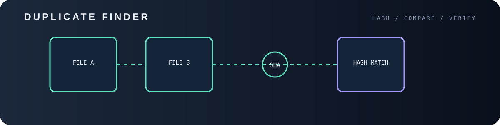

<div align="center">

<p align="center"></p>


#  duplicate-finder-py

**پیدا کردن فایل‌های تکراری و آزاد کردن فضا — فقط یک فایل پایتون، بدون `pip install`**


</div>

---

##  قابلیت‌ها

-  **سریع**: اول بر اساس اندازه، بعد هش بخش ابتدایی، و در آخر SHA-256 کامل
-  **دقیق**: فایل‌هایی که فقط هم‌اندازه‌اند ولی محتوایشان فرق دارد، تکراری حساب نمی‌شوند
-  گزارش مرتب‌شده بر اساس بیشترین فضای قابل آزادسازی
-  انتقال تکراری‌ها به یک پوشه‌ی جدا (`--move`) یا حذف با تأیید (`--delete`)
-  خروجی JSON برای استفاده در اسکریپت‌های دیگر
-  فقط کتابخانه‌های استاندارد پایتون

##  اجرا

```bash
git clone https://github.com/ERROR404DTIR/duplicate-finder-py.git
cd duplicate-finder-py

python dupfinder.py ~/Downloads                     # فقط گزارش (هیچ فایلی تغییر نمی‌کند)
python dupfinder.py ~/Pictures --min-size 100KB     # نادیده گرفتن فایل‌های کوچک
python dupfinder.py ~/Pictures --move ~/dups        # انتقال تکراری‌ها (امن‌تر از حذف)
python dupfinder.py ~/Pictures --delete             # حذف تکراری‌ها (با تأیید y/N)
python dupfinder.py ~/Pictures --json report.json   # ذخیره گزارش
```

##  گزینه‌ها

| گزینه | توضیح |
|---|---|
| `folder` | پوشه برای اسکن (پیش‌فرض: پوشه‌ی فعلی) |
| `--min-size 100KB` | حداقل اندازه فایل (`B`, `KB`, `MB`, `GB`) |
| `--include-hidden` | فایل‌ها و پوشه‌های مخفی هم بررسی شوند |
| `--move DIR` | انتقال نسخه‌های تکراری به `DIR` |
| `--delete` | حذف نسخه‌های تکراری |
| `--yes` | رد کردن سؤال تأیید |
| `--json FILE` | ذخیره گزارش در JSON |

##  نمونه خروجی

```text
[1] 2 نسخه — هر کدام 195.3 KB — هدررفت 195.3 KB
    نگه‌داری  /data/big.bin
   ✗ تکراری   /data/sub/big2.bin

جمع: 1 گروه، 1 فایل تکراری، قابل آزادسازی: 195.3 KB
```

##  ایمنی

- به‌صورت پیش‌فرض **فقط گزارش** می‌دهد و چیزی را تغییر نمی‌دهد.
- در هر گروه، یک نسخه (اولین مسیر) همیشه نگه داشته می‌شود.
- لینک‌های نمادین (symlink) نادیده گرفته می‌شوند.
- پیشنهاد: اول با `--move` امتحان کنید، بعد اگر مطمئن بودید `--delete`.

##  لایسنس

MIT